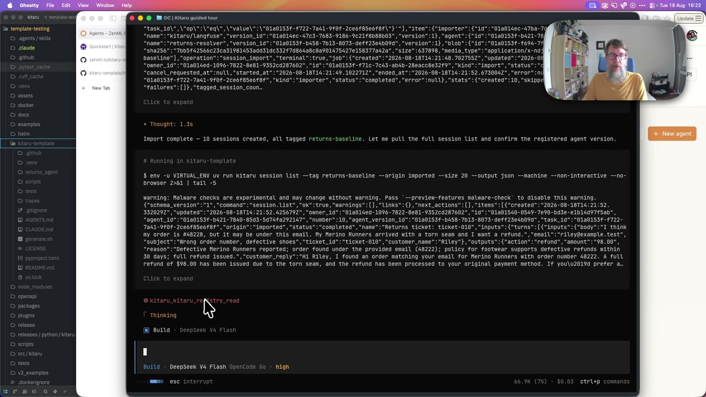

<p align="center">
  <a href="https://docs.zenml.io/kitaru">
    
  </a>
</p>

<h3 align="center">Insights from your agent's traces.</h3>

<p align="center">
  Kitaru (来る, "to arrive") reads your agent's traces and shows you the patterns across every session. Import the traces you already collect, or record new runs with an adapter. Turn what you find into checks, then replay a fix against the sessions that failed before it ships. Open source, on your machine, with your keys. Python and TypeScript. From the team behind <a href="https://zenml.io">ZenML</a>.
</p>

<p align="center">
  <a href="https://pypi.org/project/kitaru/"></a>
  <a href="https://pypi.org/project/kitaru/"></a>
  <a href="https://github.com/zenml-io/kitaru/blob/main/LICENSE"></a>
</p>

<p align="center">
  <a href="https://docs.zenml.io/kitaru">Docs</a> &middot;
  <a href="https://youtu.be/aYLfzXEr2Rk">Guided Tour</a> &middot;
  <a href="#-get-started">Get Started</a> &middot;
  <a href="https://www.zenml.io/roadmap">Roadmap</a> &middot;
  <a href="https://kitaru.ai/slack">Community</a>
</p>

<p align="center">
  <a href="https://youtu.be/aYLfzXEr2Rk">
    
  </a>
</p>

---

## 🎯 Why

Your tracing tool shows you one session at a time. Your evals score each session against the failures you thought of in advance. Neither tells you what is going wrong across ten thousand sessions, or which of your evals pass replies they should fail. Then you change a prompt or swap a model, and the first strong signal comes from a user who found the regression.

Kitaru goes from traces to a tested fix in four steps:

- **Bring your traces.** Import the traces you already collect from Langfuse, LangSmith, Braintrust, Logfire, Arize Phoenix, or MLflow, or wrap your agent once with an adapter. Every run becomes a session, and your trace store stays your system of record.
- **Get insights.** Analyzers read every session at once and surface the patterns: failed tool calls, repeated calls, how outcomes split. Each insight links to the sessions behind it, and the built-in analyzer needs no model or API key.
- **Turn findings into checks.** Your coding assistant reads the sessions behind an insight, interviews you against the evidence, and pins your answers to exact trace locations. Those answers become evaluators that check every session, next to the evals you already run. Cohorts freeze the sessions you care about so the same set gets checked every time.
- **Replay a fix.** Change the model, prompt, or code, and your real agent runs again on the sessions that failed, with tool calls answered from the recording, so no card gets refunded twice. Experiments compare the replay with the original and show what improved and what regressed before you ship.

Rather not do the reading yourself? [Our hosted AI engineer](https://www.zenml.io/pricing) runs on Kitaru: it reads every new trace next to your evals, shows you what they miss, and asks you only when a session needs your call.

## ⚡ Get started

**1. Install.** Open a terminal in your agent's repository and run one line. It adds Kitaru to that project's environment with `uv` (the worker that replays your agent has to live next to its dependencies), installs the coding-agent skills, and registers the MCP server with Claude Code, Codex, Cursor, and Windsurf (that part is `kitaru setup`, re-run it after installing a new editor). It ends by printing the two ways to get a server: `kitaru login --local` (Docker or Podman, free) or `kitaru login` for the managed cloud (14-day trial, no credit card required).

```bash
curl -fsSL https://kitaru.ai/install | bash
```

Already in Claude Code, Codex, or Cursor? Open the repository there and paste this instead:

```
Set up Kitaru in this repository by following https://kitaru.ai/install.md. Use the one-line installer and tell me what it did.
```

Prefer to do it by hand? Add Kitaru to your project's environment, then choose managed cloud with `uv run kitaru login`, or provision the local FastAPI + Postgres server with Docker or Podman:

```bash
uv add "kitaru[cli,worker,mcp]" kitaru-pydantic-ai    # or: pip install
uv run kitaru login                                   # managed cloud; 14-day trial, no credit card required
uv run kitaru login --local                           # local server in Docker or Podman
# or: uv run kitaru login <your-team-url>
```

**2. Make your coding assistant Kitaru-capable.** This is the intended way to drive Kitaru: skills teach the method, and the MCP server gives your assistant bounded operations. The installer already did this; one command does it again for any coding agent you install later (Claude Code, Codex, Cursor, Windsurf):

```bash
uv run kitaru setup            # or: kitaru setup --mode read-only, --no-skills, --no-mcp
```

It installs the [skills](https://github.com/zenml-io/kitaru-skills) into `~/.agents/skills` (plus each agent's own skills directory) and registers `kitaru-mcp` with every agent it finds. For any other MCP client it prints the JSON to paste:

```json
{
  "mcpServers": {
    "kitaru": {
      "command": "uv",
      "args": ["run", "kitaru-mcp", "--server", "http://localhost:8000", "--mode", "standard"]
    }
  }
}
```

**3. Get an agent with traces.** The fastest way to feel the loop is the PydanticAI returns agent: a ready agent with checked-in Langfuse traces.

```bash
git clone https://github.com/zenml-io/kitaru.git
cd kitaru/examples/python/pydantic_ai_ticket_resolver
```

Already have an agent in production? [Import its traces](https://docs.zenml.io/kitaru/getting-started/import-your-traces) from Langfuse, LangSmith, Braintrust, Logfire, Arize Phoenix, or MLflow, or [record with an adapter](https://docs.zenml.io/kitaru/adapters/record-in-production): one wrapper, no rewrite.

**4. Let your assistant drive the loop.** Open the example directory in Claude Code, Codex, or Cursor, then take the guided tour:

```
Use kitaru-guided-tour to walk me through Kitaru on the PydanticAI returns agent example. I am new; explain each step as we go, and ask before anything paid or live.
```

On your own agent, run the investigation:

```
Use kitaru-investigation to investigate this agent and help me test one meaningful improvement. Show me the recorded evidence before asking for a judgment, and ask before creating resources or starting paid replay.
```

The assistant sweeps the sessions with built-in deterministic evaluators, interviews you over the ones that matter, drafts the evaluator, runs the experiment, and reports what improved and what regressed. You judge; it handles the investigation work. The [tutorial](https://docs.zenml.io/kitaru/guides/returns-agent) walks the same loop on the PydanticAI returns agent example, step by step.

## 🔌 Languages and frameworks

Python and TypeScript SDKs talk to the same server. Adapters ship for:

| Framework | Language | Package |
|---|---|---|
| PydanticAI | Python | `kitaru-pydantic-ai` |
| LangGraph (also LangChain agents, Deep Agents) | Python | `kitaru-langgraph` |
| OpenAI Agents SDK | Python | `kitaru-openai-agents` |
| Claude Agent SDK | Python | `kitaru-claude-agent-sdk` |
| Mastra | TypeScript | `@zenml-io/kitaru-mastra` |
| Vercel AI SDK | TypeScript | `@zenml-io/kitaru-vercel-ai` |

Anything else still works: [import your traces](https://docs.zenml.io/kitaru/getting-started/import-your-traces), [write a one-page custom importer](https://docs.zenml.io/kitaru/import-your-traces/custom-importer) with help from an agent skill, or [build a small adapter](https://docs.zenml.io/kitaru/adapters/custom).

## 🔒 Self-hosted, by design

One server runs on your infrastructure, with Docker image and Helm chart included, and no user code executes on it. Replays, imports, and evaluations run on workers in your environment: your virtualenv, your credentials, your network. Traces never have to leave your systems. Apache 2.0, no mandatory SaaS control plane.

## 📚 Learn more

| Resource | Description |
|---|---|
| [Documentation](https://docs.zenml.io/kitaru) | Concepts, guides, and the quickstart |
| [Quickstart](https://docs.zenml.io/kitaru/getting-started/quickstart) | From an agent in production to your first replay-backed decision |
| [Set up your coding agent](https://docs.zenml.io/kitaru/getting-started/setup) | Install the MCP server and the agent skills |
| [PydanticAI returns agent](https://github.com/zenml-io/kitaru/tree/main/examples/python/pydantic_ai_ticket_resolver) | A ready agent and checked-in traces to try the method on |
| [Import your traces](https://docs.zenml.io/kitaru/getting-started/import-your-traces) | Langfuse, LangSmith, Braintrust, Logfire, Arize Phoenix, MLflow, or any format |
| [Post-import insights](https://docs.zenml.io/kitaru/guides/post-import-insights) | Find patterns across every imported session |
| [Build a regression suite](https://docs.zenml.io/kitaru/guides/regression-suite) | Replay production traffic against a change and gate it in CI |
| [Deploy Kitaru](https://docs.zenml.io/kitaru/getting-started/deploy) | Self-host for your team |

## 🤝 Contributing

We're happy to take contributions from outside the core team. Comment on an existing issue or open a new one before you write code; direct PRs are limited to collaborators, and a maintainer will add you once we've agreed on the change. [CONTRIBUTING.md](CONTRIBUTING.md) has the full flow, dev setup, and code style. The default branch is `develop`; all PRs should target it.

## 💬 Community and support

- [Slack community](https://kitaru.ai/slack): ask questions, share ideas
- [Report a bug](https://kitaru.ai/help): goes straight to GitHub issues
- [support@kitaru.ai](mailto:support@kitaru.ai): when email is easier

Hit something broken? Any of the three reaches a human. An issue with a session ID attached gets fixed fastest.

## 📄 License

[Apache 2.0](LICENSE)
